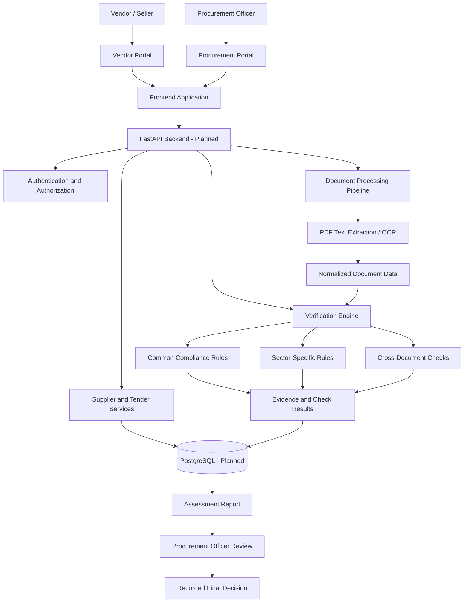

# TenderStream

### AI-Powered Bid Compliance Verification Platform for GeM Procurement

\<p align="center">
&#x20; An intelligent, evidence-driven procurement compliance platform designed to help procurement teams review bidder documents, assess compliance, and make more transparent supplier-selection decisions.
\</p>

\<p align="center">
&#x20; \
&#x20; \
&#x20; \
&#x20; \
&#x20; \
\</p>

---

## 1. Overview

**TenderStream** is a proposed AI-assisted bid compliance verification platform for public procurement workflows associated with the Government e-Marketplace (GeM) ecosystem.

Procurement involves reviewing tender requirements, supplier information, technical specifications, eligibility conditions, declarations, certificates, and other supporting documents. Manually reviewing large numbers of documents can be time-consuming and can make it difficult to maintain consistent, traceable assessments.

TenderStream aims to organize this process through a unified platform that connects supplier document submission, structured compliance checks, evidence review, risk indicators, and procurement-officer decision-making.

The platform is being designed for three initial procurement sectors:

- **Electronics & IT Equipment:** Computers, networking equipment, accessories, specifications, warranty requirements, and applicable OEM documentation.
- **Healthcare & Medical Equipment:** Medical devices, product specifications, warranties, and applicable regulatory documentation.
- **Civil Works & Infrastructure:** Contractor eligibility, work experience, completion certificates, equipment requirements, and applicable financial and technical criteria.

The current milestone focuses on the frontend UI prototype, role-based journeys, and supplier-discovery experience. Backend services, persistent storage, document-processing pipelines, and the verification engine are planned future development stages.

## 2. Problem Statement

Public procurement can involve multiple bidders, extensive supporting documents, technical requirements, eligibility conditions, and sector-specific compliance criteria.

A procurement team may need to:

- Review multiple documents for each bidder.
- Compare submitted information with tender requirements.
- Identify missing, inconsistent, expired, or insufficient evidence.
- Apply different rules to different procurement sectors.
- Maintain a clear record of checks, exceptions, and officer decisions.
- Compare eligible suppliers without relying on an unexplained score alone.

A structured and evidence-oriented workflow can help organize these activities, reduce repetitive review effort, and improve the consistency and traceability of procurement assessments.

## 3. Proposed Solution

TenderStream is being developed around two primary user journeys.

### A. Procurement Officer Portal

The procurement officer's workflow is designed to support supplier discovery and assessment.

1. Select a procurement sector.
2. Search for a required product or service.
3. View matching supplier profiles.
4. Compare platform-generated assessment scores and check summaries.
5. Open a supplier's assessment details and inspect the associated evidence.
6. Shortlist suppliers and initiate contact.
7. In the planned verification workflow, review compliance reports and record the final procurement decision.

Tender creation and formal bid evaluation remain separate procurement workflows. Supplier discovery does not replace the official tendering or bid-submission process.

### B. Vendor / Seller Portal

The vendor's workflow is designed to support supplier information and document preparation.

1. Enter company information and contact details.
2. Select a procurement sector.
3. Create a product or service listing.
4. Select relevant PDF supporting documents.
5. Submit the profile for the planned verification workflow.
6. Track document-review status and respond to missing-evidence requests when that functionality is implemented.

Vendors should submit bids against applicable tenders through the appropriate authorized procurement process. A supplier listing is not itself an official tender submission.

## 4. Current Implementation Status

| Component                               | Status                                        |
| --------------------------------------- | --------------------------------------------- |
| Role-selection screen                   | Implemented in frontend prototype             |
| Procurement officer portal              | Implemented with illustrative supplier data   |
| Sector selection and item search        | Implemented in frontend prototype             |
| Supplier score sorting                  | Implemented using demo data                   |
| Assessment-detail modal                 | Implemented with illustrative check summaries |
| Shortlist interaction                   | Frontend-only state                           |
| Contact vendor action                   | Opens a prefilled email draft                 |
| Vendor profile form                     | Implemented in frontend prototype             |
| PDF file selection and removal          | Implemented locally in the browser            |
| Backend API                             | Planned                                       |
| Authentication and authorization        | Planned                                       |
| Database and persistent storage         | Planned                                       |
| Server-side document upload             | Planned                                       |
| PDF text extraction and OCR             | Planned                                       |
| Rules-based compliance engine           | Planned                                       |
| Sector-specific verification modules    | Planned                                       |
| AI-generated explanations               | Planned                                       |
| Audit trail and reports                 | Planned                                       |
| Authorized external-source integrations | Planned, subject to access and permissions    |
| Live GeM integration                    | Not implemented or claimed                    |

**Important:** The current application is a UI prototype. Supplier profiles, assessment scores, document labels, and check summaries shown in the demo are illustrative. The frontend does not authenticate uploaded documents, verify government registrations, issue official certifications, or make final procurement eligibility decisions.

## 5. Technology Stack

### Frontend — Current

- **React.js:** Component-based user interface.
- **Vite:** Development server and frontend build tooling.
- **React Router DOM:** Client-side navigation between portal screens.
- **Lucide React:** Interface icons.
- **Recharts:** Charting dependency available for dashboard visualizations.
- **CSS:** Layout, responsive styling, cards, tables, forms, and status indicators.

### Backend — Planned

- **Python:** Core backend and verification logic.
- **FastAPI:** REST API development.
- **Pydantic:** Request validation and structured data models.
- **SQLAlchemy 2.x:** Database access and ORM.
- **Alembic:** Database schema migrations.
- **PostgreSQL:** Persistent relational storage.
- **PyMuPDF / pdfplumber:** PDF text extraction, selected according to document requirements.
- **OCR engine:** Extraction from scanned documents, if needed.
- **Rules-based engine:** Deterministic checks against tender requirements.
- **LLM integration:** Planned for structured assistance, summaries, and explanations, with evidence references and human review.

The backend stack describes the intended architecture; these components should not be considered installed or operational until they are implemented.

## 6. System Architecture

The following diagram represents the **proposed target architecture**, not a claim that all components currently exist.



### Architecture principles

- Keep the frontend separate from backend business logic.
- Separate common compliance checks from sector-specific rules.
- Preserve evidence and reasons for each result.
- Keep deterministic eligibility checks separate from AI-generated explanations.
- Record human review and final decisions independently from automated assessments.
- Distinguish actual verification, pending review, missing evidence, unavailable checks, and simulated results.
- Integrate external sources only when the relevant access, authorization, and technical interfaces are available.

## 7. End-to-End Data Flow

The following workflow describes the intended complete system once the backend and verification pipeline have been implemented.

### Step 1 — User entry and role selection

The user chooses either the procurement officer journey or the vendor/seller journey.

In the planned system, authentication and role-based authorization will determine which actions and records the user may access.

**Current:** Role selection and navigation are implemented in the frontend. Real authentication is not yet implemented.

### Step 2 — Supplier profile and document submission

The vendor enters company details, selects a sector, describes the offered product or service, and prepares the supporting documents.

The future backend will validate file types and sizes, apply access controls, store uploaded files securely, and associate each document with its supplier, listing, or relevant tender.

**Current:** The vendor can select and remove PDF files in the browser. Files are not uploaded to a server or stored persistently.

### Step 3 — Document extraction and normalization

The planned processing pipeline will:

1. Validate uploaded files.
2. Extract text from machine-readable PDFs.
3. Use OCR for supported scanned documents when required.
4. Normalize extracted text, dates, identifiers, units, and other structured fields.
5. Record extraction errors and confidence limitations.
6. Associate extracted information with its source document and page where possible.

Documents that cannot be reliably interpreted should be flagged for manual review rather than silently treated as compliant.

### Step 4 — Requirement identification

The system will obtain applicable requirements from the relevant tender's structured criteria and, where implemented, assist with extracting requirements from tender documents.

Requirements may include mandatory eligibility conditions, technical specifications, financial thresholds, certificates, validity periods, and supporting evidence.

Extracted requirements should be reviewed and approved where automated interpretation could change eligibility.

### Step 5 — Compliance verification

The verification engine will compare the normalized supplier evidence with the applicable tender requirements.

The proposed checks include:

- **Presence checks:** Is required evidence provided?
- **Validity checks:** Is a date or validity period acceptable?
- **Specification checks:** Do submitted specifications satisfy the required conditions?
- **Consistency checks:** Do company names, identifiers, dates, or figures conflict across documents?
- **Threshold checks:** Are applicable financial or experience criteria satisfied?
- **Sector-specific checks:** Are the relevant technical and documentary conditions addressed?
- **Source checks:** Can a claim be confirmed using an authorized, available external source?

Each check should produce a result, a reason, and an evidence reference whenever possible.

### Step 6 — Structured results and scoring

The planned engine will store individual check results before generating a summary assessment.

Possible result states include:

- `verified`
- `failed`
- `missing`
- `pending`
- `not_applicable`
- `unavailable`
- `simulated`
- `manual_review`

A future assessment score may summarize configured checks using documented weights. The scoring formula, rule-set version, and assessment timestamp should be retained.

A high score must not automatically override a failed mandatory eligibility condition. Missing evidence must not be interpreted as proof of fraud or misconduct.

### Step 7 — Supplier discovery and comparison

The procurement officer selects a sector, searches for a product or service, and views matching supplier profiles.

The intended production system will show relevant assessment information, check status, evidence availability, unresolved issues, and the basis for any ranking. Results should be filterable and explainable rather than presented as an unexplained AI judgment.

**Current:** Search, sector filtering, score sorting, and supplier-detail views operate on illustrative frontend data.

### Step 8 — Human review and final decision

The procurement officer reviews the underlying evidence, investigates unresolved checks, and records the final decision through the applicable procurement process.

The planned system will maintain a record of the decision, responsible reviewer, timestamp, supporting rationale, and any subsequent changes.

Automated assessments are intended to support—not replace—authorized procurement decisions.

### Step 9 — Reporting and auditability

The planned reporting layer will provide assessment summaries, check-level results, evidence references, unresolved issues, and review history.

Audit events will support traceability for significant actions such as document submission, assessment execution, rule changes, and officer decisions.

## 8. Sector-Specific Verification Design

The following are proposed rule categories. Their applicability must be configured against the actual tender conditions and relevant legal or regulatory requirements.

### Electronics & IT Equipment

- Processor, RAM, storage, and other required technical specifications.
- Product model and manufacturer consistency.
- Warranty and support commitments.
- Applicable OEM authorization and product certifications.
- Completeness of technical datasheets and declarations.

### Healthcare & Medical Equipment

- Device identity and model consistency.
- Technical specifications and accessories.
- Warranty and maintenance conditions.
- Applicable registration, certification, or regulatory evidence.
- Document validity and consistency.

Regulatory requirements vary by product and context; the system must not assume that every medical device requires the same approvals.

### Civil Works & Infrastructure

- Contractor registration and applicable eligibility.
- Similar-work experience and completion evidence.
- Financial thresholds where specified in the tender.
- Equipment and personnel requirements.
- BOQ arithmetic and document completeness.
- Consistency between declarations, certificates, and submitted figures.

Passing a document check does not independently establish the authenticity of a certificate or the overall eligibility of a bidder.

## 9. Project Folder Structure

This section distinguishes the existing frontend from the intended future backend architecture. File availability may change as development continues.

```text
gem-bid-compliance/
│
├── README.md
├── .gitignore
│
├── frontend/
│   ├── public/
│   │   ├── logo.svg
│   │   └── assets/
│   │
│   ├── src/
│   │   ├── app/
│   │   │   └── App.jsx
│   │   │
│   │   ├── layouts/
│   │   │   └── DashboardLayout.jsx
│   │   │
│   │   ├── features/
│   │   │   ├── auth/
│   │   │   │   └── pages/
│   │   │   │       └── RoleSelectionPage.jsx
│   │   │   │
│   │   │   ├── buyer/
│   │   │   │   └── pages/
│   │   │   │       └── BuyerHomePage.jsx
│   │   │   │
│   │   │   ├── vendor/
│   │   │   │   └── pages/
│   │   │   │       └── VendorHomePage.jsx
│   │   │   │
│   │   │   ├── dashboard/
│   │   │   │   └── pages/
│   │   │   │       └── DashboardPage.jsx
│   │   │   │
│   │   │   └── shared/
│   │   │       └── components/
│   │   │
│   │   ├── styles/
│   │   │   └── global.css
│   │   │
│   │   └── main.jsx
│   │
│   ├── index.html
│   ├── package.json
│   ├── package-lock.json
│   └── vite.config.js
│
└── backend/                         # Planned
    ├── app/
    │   ├── main.py
    │   ├── core/
    │   │   ├── config.py
    │   │   └── security.py
    │   ├── api/
    │   │   └── v1/
    │   │       ├── auth.py
    │   │       ├── tenders.py
    │   │       ├── bidders.py
    │   │       ├── documents.py
    │   │       ├── verification.py
    │   │       ├── reports.py
    │   │       └── audit.py
    │   ├── models/
    │   ├── schemas/
    │   ├── services/
    │   │   ├── document_service.py
    │   │   ├── extraction_service.py
    │   │   └── verification_service.py
    │   ├── verification/
    │   │   ├── common_rules.py
    │   │   ├── scoring.py
    │   │   └── sectors/
    │   │       ├── electronics.py
    │   │       ├── healthcare.py
    │   │       └── civil_works.py
    │   └── db/
    │       ├── session.py
    │       └── base.py
    ├── alembic/
    ├── tests/
    ├── requirements.txt
    └── .env.example
```

**Folder-structure notes**

- `frontend/src/app/` — application routes and top-level composition.
- `frontend/src/features/auth/` — role selection and future authentication screens.
- `frontend/src/features/buyer/` — supplier search, assessment review, and procurement-facing interactions.
- `frontend/src/features/vendor/` — company profiles, listings, document submission, and status tracking.
- `frontend/src/features/dashboard/` — the earlier dashboard prototype; it may remain in the project even if the current routes do not display it.
- `frontend/src/layouts/` — reusable application layouts.
- `frontend/src/styles/` — shared visual styling.
- `backend/app/api/v1/` — planned versioned REST endpoints.
- `backend/app/models/` — planned database models.
- `backend/app/schemas/` — planned request and response validation.
- `backend/app/services/` — planned document, extraction, and verification services.
- `backend/app/verification/` — planned common and sector-specific compliance rules.
- `backend/alembic/` — planned database migrations.
- `backend/tests/` — planned automated tests.

The backend tree is a design target. Create these files progressively when implementation begins; do not treat this proposed tree as evidence that the backend already exists.

## 10. Run the Current Frontend Locally

### Prerequisites

- Node.js and npm installed.
- Git installed.
- A code editor such as Visual Studio Code.

### Installation

Clone the repository after publishing it, or open the existing project directory.

```bash
cd frontend
npm install
npm run dev
```

Open the local URL displayed by Vite, commonly:

```text
http://localhost:5173
```

### Build check

To verify that the frontend can produce a production build:

```bash
npm run build
```

The generated build output is intended for deployment. It is excluded from Git because it can be regenerated from the source code.

## 11. Planned API Design

The following endpoints are proposed for the future backend and are not implemented by the current UI prototype.

| Endpoint                             | Purpose                                           |
| ------------------------------------ | ------------------------------------------------- |
| `POST /api/v1/auth/login`            | Authenticate users                                |
| `GET /api/v1/dashboard/summary`      | Retrieve dashboard metrics                        |
| `GET /api/v1/tenders`                | List tenders                                      |
| `POST /api/v1/tenders`               | Create a tender as an authorized procurement user |
| `GET /api/v1/bidders`                | Retrieve bidder or supplier profiles              |
| `POST /api/v1/bidders`               | Register a supplier profile                       |
| `POST /api/v1/documents/upload`      | Upload and associate supporting documents         |
| `POST /api/v1/verification-runs`     | Execute an authorized verification run            |
| `GET /api/v1/verification-runs/{id}` | Retrieve assessment status and results            |
| `GET /api/v1/reports/{id}`           | Retrieve a compliance report                      |
| `GET /api/v1/audit`                  | Retrieve authorized audit records                 |
| `POST /api/v1/officer-decisions`     | Record an officer's review decision               |

Actual endpoint names, request schemas, authorization policies, and response formats will be finalized during backend implementation.

## 12. Security, Transparency, and Responsible AI

TenderStream is intended for a sensitive procurement context. The production implementation should address:

- Authentication, role-based access control, and organization-level data isolation.
- Server-side validation of uploaded files and file-size limits.
- Secure document storage, access restrictions, and retention policies.
- Protection of secrets through environment variables and managed secret storage.
- Audit logging for significant actions and final decisions.
- Evidence-linked results so reviewers can understand why a check passed or failed.
- Clear separation of mandatory eligibility conditions from aggregate assessment scores.
- Human review for ambiguous, conflicting, or low-confidence evidence.
- Explicit labels for pending, unavailable, manual, and simulated checks.
- Authorized use of external data sources and appropriate handling of personal or confidential information.

AI-generated explanations must not be treated as independent proof of compliance. The production system should preserve source evidence and enable authorized reviewers to challenge or correct automated results.

## 13. Development Roadmap

The project will be developed incrementally.

- [x] Initialize the React + Vite frontend.
- [x] Create the initial role-selection experience.
- [x] Build the procurement officer supplier-discovery prototype.
- [x] Build the vendor profile and local PDF-selection prototype.
- [ ] Add authentication and role-based authorization.
- [ ] Implement FastAPI backend foundations.
- [ ] Design the PostgreSQL schema and migrations.
- [ ] Implement secure document upload and storage.
- [ ] Build PDF extraction and OCR handling.
- [ ] Implement common deterministic compliance rules.
- [ ] Add electronics, healthcare, and civil-works rule modules.
- [ ] Store evidence, check results, and rule-set versions.
- [ ] Implement assessment scoring and explainable reports.
- [ ] Add officer review, final decisions, and audit events.
- [ ] Add automated tests, security checks, and deployment configuration.
- [ ] Integrate external sources only where authorized and technically supported.

## 14. Engineering Approach

The project follows a modular architecture intended to separate presentation, data management, document processing, and verification logic.

The proposed implementation emphasizes:

- **Modularity:** Sector rules can be maintained independently.
- **Traceability:** Results should be connected to evidence and rule versions.
- **Explainability:** Each finding should include a reason, not just a score.
- **Human oversight:** Authorized procurement officers retain responsibility for decisions.
- **Extensibility:** Additional sectors and checks can be introduced without redesigning the entire application.
- **Honest integration status:** Simulated data and unavailable external checks are clearly distinguished from confirmed results.

## 15. Contribution and Future Development

The project is currently maintained as a final-year engineering capstone.

Future development can proceed through incremental commits and pull requests. Proposed contributions should preserve the separation between frontend components, backend services, sector rules, and evidence-processing logic.

Before submitting changes, verify that:

1. The frontend installs successfully.
2. The application runs locally.
3. The production build completes.
4. No secrets, credentials, private documents, or personal data are committed.
5. New functionality is accurately described in the README.

## 16. Project Disclaimer

TenderStream is an academic engineering project and prototype. It is not an official GeM product, does not claim government endorsement, and does not replace the authorized procurement process.

Unless explicitly implemented and independently confirmed, verification outcomes, supplier rankings, external-source checks, and compliance reports should be treated as illustrative or provisional. Final eligibility and procurement decisions must follow the applicable tender conditions and authorized procedures.

---

**Project:** TenderStream
**Category:** Artificial Intelligence · Public Procurement · Document Intelligence · Compliance Automation
**Current milestone:** Frontend UI prototype
**Future direction:** Evidence-driven, explainable, and auditable bid compliance verification
